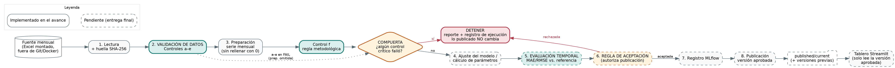

# Alcance del flujo — Laboratorio 11 (MLOps)

Observatorio de Turismo · CC3066 Data Science · UVG · Semestre II 2026
Estado: **AVANCE (29/oct/2026)**. Los puntos marcados **CONFIRMAR** son decisiones del grupo aún abiertas.

## 1. Qué estima el flujo

| Elemento | Definición |
|---|---|
| Variable | Ingreso mensual de visitantes no residentes (turistas y excursionistas) |
| Unidad | Visitantes por mes |
| Nivel de agregación | Mes × total del destino; desgloses por vía de ingreso, región de origen y agrupación de residencia |
| Destino | Guatemala (total país). **CONFIRMAR** que coincide con el destino asignado al grupo |
| Fuente | `Base_Migracion_2009-2026jun.xlsx` (registros mensuales de ingreso de viajeros, la misma del Lab 2/10). Se monta en `data/raw/` o se indica con `--data`; no se versiona ni se incluye en imágenes Docker |
| Columnas usadas | `Viajero` (conteo), `Vía`, `Región dos`, `Agrupación Residencia` (de `dashboard/loaders.py`); `Año` y `Mes` (**CONFIRMAR** nombres reales) |
| Población de referencia | Filtros definidos en el Lab 2 (`lstm_lab2.data._reference_population`). Hoy `filters: []` en la configuración — **CONFIRMAR** y trasladarlos |
| Cobertura esperada | 2009-01 a 2026-06 (configurable en `periods`) |

## 2. Períodos, parámetros y supuestos

| Elemento | Valor provisional (en `config/config.yaml`) |
|---|---|
| Ajuste | 2009-01 a 2023-12 (propuesta) |
| Evaluación | 2024-01 a 2025-12, ocultando cada mes y usando solo información anterior (origen móvil) (propuesta) |
| Referencia sencilla | Último valor observado; promedio histórico con datos previos al mes evaluado |
| Factor de reparto | **CONFIRMAR**: definir según la guía del proyecto; hoy `parameters.allocation_factor: null` |
| Semilla | 42 (`run.seed`) |
| Enero y febrero de 2026 | **CONFIRMAR** cobertura real. Si no hay valores observados comparables no se calculan errores; se declaran en `allowed_missing_months` |

Supuestos: la fuente es mensual; los meses sin cobertura no se convierten en cero (quedan vacíos y marcados `cobertura=False`); no se suman presencias diarias.

> Nota sobre el Lab 10: `dashboard/loaders.py` usa `asfreq("MS", fill_value=0.0)`, que convierte meses sin datos en cero. El pipeline **no** replica ese comportamiento, y en la versión final el tablero leerá la serie del pipeline.

## 3. Archivo de resultados que usará el tablero (se implementa en la entrega final)

`published/current/estimaciones.csv`, con una fila por destino y mes:

| Columna | Contenido |
|---|---|
| `destino` | Destino estimado |
| `periodo` | Mes (AAAA-MM-01) |
| `tipo` | `observado` o `estimado` |
| `valor`, `unidad` | Cifra y unidad (visitantes por mes) |
| `run_id` | Identificador de la ejecución en MLflow/registro |
| `fecha_generacion` | Fecha y hora UTC |
| `version_procedimiento` | Versión del procedimiento (`pipeline.__version__`) |

Junto a él: `metadata.json` con la métrica de validación, los meses evaluados, el commit y la huella de la fuente.

## 4. Diagrama

Ver `docs/diagrama_flujo.png` (fuente: `docs/flujo.dot`). Se valida en los pasos 2 y control f, se evalúa en el paso 5 y se autoriza la publicación en la regla de aceptación (paso 6).

## 5. Qué incluye el avance y qué falta

Implementado: lectura con huella digital, seis controles de calidad con reporte, preparación sin relleno de ceros, compuerta que detiene antes de publicar, registro por ejecución, 26 pruebas automáticas.
Pendiente (entrega final): ajuste/estimación, evaluación temporal y regla de aceptación, MLflow, publicación versionada y restauración, lectura del tablero, monitoreo, Docker y README completo.
