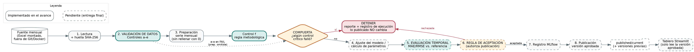

# Alcance del flujo — Laboratorio 11 (MLOps)

Observatorio de Turismo · CC3066 Data Science · UVG · Semestre II 2026
Estado: **AVANCE (29/oct/2026)**. Los puntos marcados **CONFIRMAR** son decisiones del grupo aún abiertas.

## 1. Qué estima el flujo

| Elemento | Definición |
|---|---|
| Variable | Ingreso mensual de visitantes no residentes a Guatemala: **Turista + Excursionista** |
| Unidad | Visitantes por mes (la fuente trae decimales: son estimaciones expandidas de encuesta, no conteos exactos) |
| Nivel de agregación | Mes × total del destino; desgloses por vía de ingreso, región de origen (`Región dos`) y agrupación de residencia |
| Destino | Guatemala (total país). **CONFIRMAR** que coincide con el destino asignado al grupo |
| Fuente | `Base_Migracion_2009-2026jun.xlsx`, hoja `Datos` (la misma del Laboratorio 2; la hoja `Notas` documenta la fuente). 161,036 filas, 13 columnas. Se coloca en `data/raw/` o se indica con `--data`; no se versiona ni se incluye en imágenes Docker |
| Columnas usadas | `Año`, `Mes cod` (fecha), `Viajero` (medida), `Tipo de Viajero` (población), `Vía`, `Frontera`, `País`, `Región dos`, `Agrupación Residencia` |
| Población de referencia | `Tipo de Viajero` ∈ {Turista, Excursionista}. Según `Notas`, «Viajero» (cruce fronterizo sin ser visitante) no cuenta como visitante y «Cruceristas» solo existe hasta 2022. Pasan 137,642 de 161,036 filas |
| Granularidad / clave | Una fila por mes × vía × frontera × país × agrupación de residencia × tipo de viajero. Sin la agrupación de residencia aparecen 42 falsos duplicados |
| Cobertura | Enero 2009 a junio 2026: 210 meses consecutivos, sin huecos (verificado por el control b) |
| Fuente de la serie | La fuente es **mensual**; la serie mensual sale de sumar sus filas, no de presencias diarias |

## 2. Períodos, parámetros y supuestos

| Elemento | Valor provisional (en `config/config.yaml`) |
|---|---|
| Ajuste | 2023-01 a 2024-12 como ventana inicial (se expande mes a mes) — propuesta |
| Evaluación | 2025-01 a 2025-12, origen móvil: cada mes se estima solo con datos anteriores — propuesta |
| Referencia sencilla | Último valor observado; promedio histórico con datos previos al mes evaluado |
| Factor de reparto | **CONFIRMAR**: definir según la guía del proyecto; hoy `parameters.allocation_factor: null` |
| Semilla | 42 (`run.seed`) |

**Por qué 2023 en adelante.** `Notas` indica tres tramos de fuente y un quiebre metodológico 2022→2023 (sistema depurado del INGUAT, que excluye compradores fronterizos frecuentes y ajusta arribos marítimos): los niveles no son comparables con 2022 hacia atrás. Además, 2020–2021 es el piso de la pandemia (~27 % de 2019). Por eso el ajuste y la evaluación usan solo el tramo homogéneo; los meses previos a 2023 se leen y validan pero no son obligatorios (sin datos ahí solo habría advertencia).

**Enero y febrero de 2026.** El archivo trae enero–junio de 2026 completos, así que no hay hueco que declarar (`allowed_missing_months: []`). La limitación es otra: el archivo es una sola foto final y no guarda lo que estaba disponible en cada fecha de corte, por lo que ocultar meses simula la situación pero no reproduce lo que se sabía en enero o febrero de 2026. **CONFIRMAR** con la guía cómo tratar esos meses en la evaluación.

Supuestos: los meses sin cobertura no se convierten en cero (quedan vacíos y marcados `cobertura=False`); no se suman presencias diarias.

## 3. Limitaciones de la fuente que debe comunicar el tablero

- Uso exclusivamente académico; no son cifras oficiales.
- Quiebre metodológico 2022→2023 y cambio de granularidad de `País` desde 2023 (de país individual a 27 agrupaciones de mercado).
- La vía marítima pierde detalle desde 2017 (cambio de registro); los cruceros dejan de figurar desde 2023.
- Pandemia: colapso en marzo de 2020, piso 2020–2021, recuperación en 2022.
- 2026 cubre solo enero–junio.

## 4. Observaciones sobre el Laboratorio 2 y el tablero del Lab 10

- `lab2_main.py` construye «Total» sumando **todos** los tipos de viajero (incluye «Viajero» y cruceristas) y rellena con cero (`fillna(0)`, `asfreq("MS").fillna(0)`). Con esta fuente no hay meses faltantes, así que el relleno no altera hoy los números, pero la regla del Lab 11 lo prohíbe. El pipeline no lo replica. El efecto de mezclar tipos es grande en el quiebre: de 2022 a 2023 el total de todos los tipos cae 24.7 %, mientras que los visitantes (Turista + Excursionista) caen 9.6 %.
- Su partición 70/30 deja la prueba en abril 2021 – junio 2026, que cruza la pandemia y el quiebre de 2023.
- `dashboard/loaders.py` del Lab 10 importa `lstm_lab2` y lee `Lab2DS/outputs/metrics/*.npz`; este Lab 2 trae `lab2_main.py` y `lab2_outputs/*.csv`, así que ese tablero no corre contra este submódulo. En la entrega final el tablero lee la versión aprobada del pipeline y deja de depender de `Lab2DS`.

## 5. Archivo de resultados que usará el tablero (se implementa en la entrega final)

`published/current/estimaciones.csv`, una fila por destino y mes:

| Columna | Contenido |
|---|---|
| `destino` | Destino estimado |
| `periodo` | Mes (AAAA-MM-01) |
| `tipo` | `observado` o `estimado` |
| `valor`, `unidad` | Cifra y unidad (visitantes por mes) |
| `run_id` | Identificador de la ejecución en MLflow/registro |
| `fecha_generacion` | Fecha y hora UTC |
| `version_procedimiento` | Versión del procedimiento (`pipeline.__version__`) |

Junto a él: `metadata.json` con la métrica de validación, los meses evaluados, el commit y la huella de la fuente.

## 6. Diagrama

Ver `docs/diagrama_flujo.png` (fuente: `docs/flujo.dot`). Se valida en los controles a–f, se evalúa en el paso 5 y se autoriza la publicación en la regla de aceptación (paso 6).

## 7. Qué incluye el avance y qué falta

Implementado: lectura con huella digital, población de referencia, seis controles de calidad con reporte, preparación sin relleno de ceros, compuerta que detiene antes de publicar, registro por ejecución, estimación estacional ingenua, validación temporal, comparación contra referencia, regla de aceptación y resultados candidatos versionados por ejecución. Verificado con el Excel real (210 meses, suma idéntica a un cálculo independiente: 46,711,912.89 visitantes) y con copias del Excel real con fallas inyectadas.
Pendiente (entrega final): MLflow, publicación versionada y restauración, lectura del tablero, monitoreo, Docker, README operativo completo e informe técnico final.
